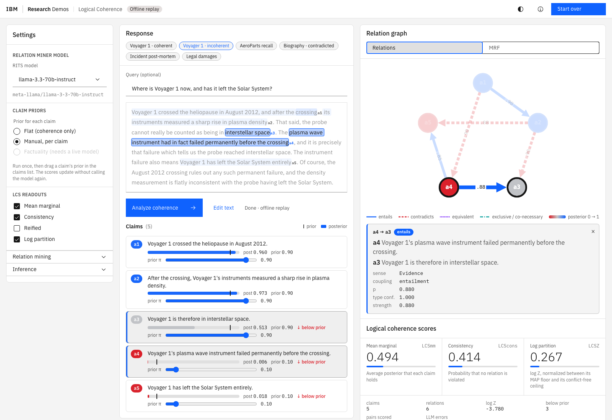

# FactReasoner demo: factuality and logical coherence

An interactive page for FactReasoner's two questions about a long-form response:

- **Factuality**: is each claim supported by evidence?
- **Coherence**: do the claims hang together?

Paste a response and the demo:

1. extracts its **atomic claims** and highlights the words in the text that state each one.
   Both analyses use this one claim set.
2. **Factuality**: checks each claim against evidence (Google, Wikipedia, or passages you
   paste). It shows each passage's support or contradiction verdict, a claim↔evidence
   graph, and every claim's posterior probability of being true.
3. **Coherence**: mines the relations between claims and draws the **relation graph**
   (entails / contradicts / equivalent / exclusive, line width = strength `p`). It then
   solves the coherence MRF for the **LCS readouts**: mean marginal, consistency and
   normalized log partition (reified is optional).
4. **Coherence with factuality priors**: runs factuality first, and uses its posteriors as the coherence priors.



**Layout.** The settings span the top in two cards: **Factuality pipeline** (blue) and
**Coherence pipeline** (purple). Both cards share one grid, so their fields line up
row by row. The cards and the panels below sit in the same two columns: the response
panel has exactly the width and edges of the factuality card, and the results panel
those of the coherence card. The panel is open by default. It hides itself when you press Analyze, to
give the results room. *Show settings* brings it back, and on a phone it starts
collapsed. Under the settings, the response and claims sit on the left. The
results sit on the right in a panel that fills the viewport.

**Analysis.** Under the response, three buttons pick what a run computes:

| Analysis | Runs | Claim priors | Results panel |
|---|---|---|---|
| **Factuality** (default) | claims → evidence → NLI → inference | n/a | Factuality only |
| **Coherence** | claims → relation miner → MRF | uniform 0.5 | Coherence only |
| **Coherence with factuality priors** | both, chained | each claim's factuality posterior | both tabs, opening on Coherence |

The settings card a run doesn't use is dimmed and marked *not used by this analysis*.
It is never hidden, so the layout doesn't move.

The layout follows the IBM Research Demos Spaces (e.g. *Speech to Decisions with
Granite*): a FastAPI backend and one hand-built page styled with the **Carbon design
system** (`@carbon/web-components`, IBM Plex, g10/g100 themes). There is no build step.

## Running it

```bash
pip install -e ".[demo,rits]"          # plus mellea-ibm, see the README

# live: RITS and/or local Ollama, plus Merlin
fact-reasoner-lcs-demo --merlin-path ~/git/merlin/build_boost192/merlin
# -> http://127.0.0.1:7860

# offline: no model server, no Merlin
fact-reasoner-lcs-demo --dry-run
```

**Models.** Each pipeline has its own model, from **Ollama** (the default) or
**RITS** (the models in `configs/rits_models.json`, which need `RITS_API_KEY`). Both
pipelines start on the local `granite4.1:3b` when it is pulled. They fall back to RITS
only when the Ollama server has no models, or in offline replay. The Ollama list
is whatever the local server has pulled, read live from `/api/tags`; use *Refresh
Ollama models* after `ollama pull`. Point it at another machine with `--ollama-host`
(default: `OLLAMA_HOST`, else `http://localhost:11434`). Without a RITS key both
pipelines start on Ollama.

| | RITS | Ollama |
|---|---|---|
| **Factuality model**: claims, reviser, summarizer | chosen model | chosen model |
| **Factuality NLI** (claim ↔ evidence) | the same model, probability from token logprobs (or SIMBA-UQ / the direct prompt) | the **`kev` decision model** on the same server |
| **Relation miner** | chosen model; strength estimator selectable | chosen model; type confidence sampled (SIMBA-UQ), strength **always verbalized** |

Claims are extracted once, by the factuality model, and both pipelines use them. In
Coherence-only mode the relation miner's model extracts them.

`kev` answers each claim–passage question in one forward pass, with a probability for
entailment, contradiction and neutral. That is much faster than prompting a small chat
model, and the probabilities are the model's own. Pull it once with `ollama pull kev`;
`--decision-model` names a different one. It is not offered as a chat model, and
Factuality mode says so if it isn't pulled. Coherence alone works without it.

**Offline (`--dry-run`).** It stubs the LLM, uses exact brute-force inference, and
lists only the **Voyager 1** pair (coherent and incoherent):

- **Coherence** replays the paper's gold relation graphs, so it reproduces the worked
  example's numbers exactly (A: 0.590 / 0.962 / 0.193, B: 0.494 / 0.414 / 0.267).
- **Factuality** runs the real FactReasoner inference against the example's three
  shipped evidence passages. A lexical stand-in replaces the NLI model, so the true
  claims come out supported and the two false ones contradicted.
- **Coherence with factuality priors** combines the two. The two responses get identical factuality (same claims,
  same evidence), and coherence separates them.

Retrieval needs a live run. Pasted text still works offline, but its claims and
relations come from the stub and don't mean anything.

If Merlin exits at once (return code -9 or -6), the binary is the problem, not the
demo. On macOS, a binary from a browser-downloaded archive carries a quarantine flag,
and macOS kills it on launch (`xattr -d com.apple.quarantine <merlin>`). A binary
linked against an older Homebrew Boost fails with `Symbol not found` or `Library not
loaded`; rebuild it against the installed Boost.

Options: `--host`, `--port` (default 7860), `--models-file`, `--data-dir` (examples,
default `data/lcs`), `--ollama-host`, `--decision-model` (default `kev`). `MERLIN_PATH`
can stand in for `--merlin-path`.

## Using it

- **Examples** sit above the editor. The Voyager pair ships evidence passages, used
  with *Paste evidence*.
- **Stop** appears next to Analyze while a run is in progress. The status shows
  *Stopping…* at once, then *Stopped · claims kept*. Claim extraction and relation
  mining are cancelled mid-call (about 0.3 s on a live Ollama run). The factuality NLI
  step, which FactReasoner runs on its own event loop, stops when it returns; a step
  that ignores the stop is cut off after 8 s. Stopping also cancels the model
  requests still in flight, so the next run starts at once instead of queueing
  behind them.
- **Claims are kept between runs.** Once a response's claims are extracted, every
  later run on the same text reuses exactly those claims (same ids, same wording),
  whatever the analysis or settings. So switching from Factuality to Coherence
  compares like with like, and skips a model call. Editing the response text, or
  *Re-extract claims*, extracts them again.
- **Each claim row** shows its factuality posterior with a ✓/✗ verdict, its coherence
  posterior against its prior, or both. **↓ below** marks a claim whose coherence
  posterior fell below its own prior: one the response's own argument undermines.
- **Hover or click** a claim in the list, the text, the evidence list or either graph,
  and it lights up everywhere. **Click a relation edge** to see the discourse sense,
  the coupling, `p = type confidence × strength`, and the miner's evidence quote
  (prompt v2), which is highlighted in the text.
- **Relations / MRF** switches the coherence graph to the factor-graph view: grey
  squares are the unary priors φᵢ, black squares the pairwise factors ψᵣ.
- **What if?** After a *Coherence* run, *What if? Edit claim priors* adds a prior
  slider to each claim, starting at the uniform 0.5. Drag one and the scores re-compute
  on the mined graph with **no model calls**. *Reset priors to 0.5* puts them back.

### Control panel

| Setting | Effect |
|---|---|
| **Factuality pipeline** | |
| Model | RITS or Ollama, and which model, for claim extraction, the reviser and the evidence summarizer. |
| NLI | RITS: how the verdict gets a probability. Ollama: fixed to the `kev` decision model. |
| Evidence source | Google (Serper; needs `SERPER_API_KEY`), Wikipedia, or **Paste evidence**: one passage per paragraph, each compared with every claim (at most 12). |
| Passages per claim / claim–evidence pairs | Retrieval depth, and which claim–passage pairs get an NLI call (*Fast* compares a passage with the claim that retrieved it and its neighbours). Pasted evidence always uses all pairs. |
| FactReasoner version | v1 per-claim contexts, v2 deduplicated contexts, v3 adds context–context relations. |
| Decontextualize / Summarize | Rewrite claims to stand alone; summarize each passage before NLI. Both run on the factuality model. |
| **Coherence pipeline** | |
| Relation miner | RITS or Ollama, and which model. |
| Relation strength | RITS: the estimator. Ollama: fixed to verbalized, since there are no logprobs. |
| Claim priors | Read-only: set by the analysis (uniform 0.5, or factuality posteriors). |
| LCS readouts | Which readouts to compute. They share the base inference runs. |
| Mining and inference | Prompt variant, sense menu, sense/coupling reconcile, candidate pairs, window radius, Merlin i-bound, concession discount, evidence-span requirement, LCS readouts. All shown, none hidden. |

Analyses are queued and run one at a time on one worker thread with a persistent
event loop. Mellea caches its async client per loop, and one run at a time also
keeps a single user from saturating the shared RITS quota or a local GPU.

## API

| Endpoint | |
|---|---|
| `GET /api/config` | RITS and Ollama chat models, the decision model's status, option menus, defaults, examples. |
| `GET /api/ollama/models` | Re-list the local Ollama models and the decision model's status. |
| `POST /api/analyze` | `{response, query?, settings, priors?, evidence?, claims?}` → `{run_id}`. `settings.mode` is `factuality`, `coherence` or `both`. `claims` (`[{id, text, original}]`) reuses an earlier run's claims instead of extracting them. |
| `POST /api/runs/{id}/stop` | Stop a queued or running analysis; its event stream ends with `stopped`. |
| `GET /api/runs/{id}/events` | Server-sent events: `queued`, `stage`, `claims`, `factuality`, `priors`, `progress`, then `result` (`{factuality, coherence, timing}`), `stopped` or `error`. |
| `POST /api/runs/{id}/rescore` | `{priors}` → coherence scores under new priors (no LLM calls). |

## How the two stages share claims

The demo atomizes once and hands those claims to FactReasoner (`has_atoms=True`),
rather than letting the factuality pipeline atomize the response again. Claim ids are
therefore identical in both views. If FactReasoner drops a duplicate claim, coherence
mines the surviving set, so the two views never disagree about which claims exist.

## How claims are located in the text

Claims are rewrites, not offsets, so `fact_reasoner.demo.spans` aligns them
lexically:

1. It picks the sentence (or pair of sentences) that best covers the claim's content
   words. Words are down-weighted by how many sentences and how many claims contain
   them, so the subject a rewrite repeats everywhere doesn't decide the match.
2. It highlights only the matching words, merged across small gaps, so a claim drawn
   from a list highlights the list head and its own item.

A claim whose best match covers under 40% of its weight is shown as *implicit in
text*: listed, but not highlighted.

## Code

- `src/fact_reasoner/demo/app.py`: FastAPI app and the CLI entry point
- `src/fact_reasoner/demo/engine.py`: staged runs (claims → factuality → coherence),
  backends, re-scoring, offline replay
- `src/fact_reasoner/demo/spans.py`: claim → span alignment
- `src/fact_reasoner/demo/static/`: the page (`index.html`, `style.css`, `app.js`)
- `tests/test_demo.py`: offline tests, including the paper's numbers and the
  factuality → coherence hand-off end to end
