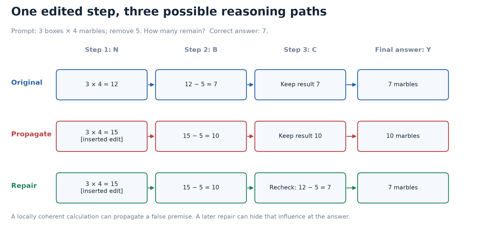

# Proof of concept: propagation and repair under CoT interventions

**Revised 16 October 2026.** This is a self-contained synthetic example and an
executable estimation experiment. All probabilities are generated by stipulated
mechanisms, not measured from an LLM. The [research plan](README.md) specifies the
subsequent real-model study.

**Question:** can a causal model predict how an edited reasoning step changes
later reasoning and the answer, including cases where the model repairs the edit?
This PoC demonstrates exact intervention calculations and learning from finite
samples under a known graph. It does not demonstrate discovery of a real model's
causal graph or a benefit from coherence features.

## 1. One problem and three reasoning paths

> There are three boxes containing four marbles each. Five marbles are removed.
> How many marbles remain?

The correct answer is `3 × 4 − 5 = 7`. An illustrative trace is:

1. “Three boxes with four marbles each give 12 marbles.”
2. “After removing five, 7 marbles remain.”
3. “The remaining count is seven.”
4. Final answer: “7 marbles.”

Replace the first statement with “Three boxes with four marbles each give 15
marbles,” then regenerate everything after it. The question stays fixed.

| Path | Subtotal | First result | Verification and commitment | Answer |
|---|---|---|---|---|
| Correct | 12 | 12 − 5 = 7 | Keep 7 | 7 |
| Corruption propagates | 15 | 15 − 5 = 10 | Keep 10 | 10 |
| Corruption is repaired | 15 | 15 − 5 = 10 | Recheck: 3 × 4 = 12, hence 7; accept 7 | 7 |

These are constructed examples, not sampled transcripts. The second path is
locally consistent with an incorrect premise. The third path shows that an edit
can change intermediate reasoning even when the final answer returns to 7.



## 2. Complete SCM

Fix X to the question, model configuration, and decoding settings. The endogenous
variables describe semantic content in a continuation:

| Variable | Domain | Observation rule |
|---|---|---|
| N | {12, 15} | Subtotal explicitly asserted at the first landmark. |
| B | {7, 10} | Remaining count first asserted after the subtotal. |
| R | {0, 1} | 1 only when an explicit successful verification is accepted at the checking landmark. |
| C | {7, 10} | Remaining count committed to after that landmark. |
| Y | {7, 10} | Canonical number in the final answer. |

R=1 repairs an error when B=10 and verifies an already correct result when B=7.
“Let me check” alone is not successful verification. The correctness outcome is
`1{Y=7}`; N, B, C, and Y are asserted values, not truth probabilities.


The graph is conditional on fixed X. Exogenous noise arrows are omitted from the
figure. Let `U_N, U_B, U_R, U_Y` be independent Uniform(0,1) variables. The SCM is
`M=(U,V,F,P_U)`, where `V=(N,B,R,C,Y)` and F contains these structural equations:

| Variable | Structural equation |
|---|---|
| N | 12 if `U_N < 0.9`, otherwise 15. |
| B | 7 if `U_B < p_B(N)`, otherwise 10. |
| R | `1{U_R < p_R(B)}`. |
| C | 7 if R=1, otherwise B. |
| Y | 7 if `U_Y < p_Y(C)`, otherwise 10. |

All mechanism probabilities are specified here:

| Mechanism | Parent state | Probability |
|---|---|---:|
| P(N=12) | None | 0.900 |
| p_B(N) = P(B=7 given N) | N=12 | 0.925 |
| p_B(N) | N=15 | 0.325 |
| p_R(B) = P(R=1 given B) | B=7 | 0.100 |
| p_R(B) | B=10 | 0.800 |
| p_Y(C) = P(Y=7 given C) | C=7 | 0.955 |
| p_Y(C) | C=10 | 0.145 |

The other probability in each binary row is its complement. C has no independent
noise. Together these tables, equations, and noise distribution fully specify
both sampling and intervention calculations.

The joint distribution factorizes as

$$
p(n,b,r,c,y)=p(n)p(b\mid n)p(r\mid b)
\mathbf1\{c=7\text{ if }r=1\text{ else }b\}\,p(y\mid c).
$$

The graph and commitment rule are assumptions. In particular, this model excludes
silent recomputation at commitment, failed checks that alter C, other numbers,
and additional dependence of Y on earlier states after C is known. Since R denotes
successful accepted verification, R=1 implying C=7 is partly definitional. It is
not evidence that merely asking for a check causes correctness. Real-model data
must retain out-of-domain and missing outcomes, then test or expand this abstraction.

## 3. Interventions and their implementation

A hard intervention `do(V=v)` **replaces V's structural equation with the constant
v**. Keep all other equations and their noise distributions, and generate their
outputs in temporal order. For example,

$$
p^{do(N=15)}(b,r,c,y)=p(b\mid15)p(r\mid b)
\mathbf1\{c=7\text{ if }r=1\text{ else }b\}\,p(y\mid c).
$$

For a joint intervention, replace every selected equation. The executable
implementation enumerates all 32 assignments and sums their truncated-product
probabilities. The normalization must remain one.

| Experiment | Simulator assignments | Quantity tested |
|---|---|---|
| Subtotal corruption | do(N=12) versus do(N=15) | Immediate propagation and total answer effect. |
| Intermediate error | do(B=7) versus do(B=10) | Verification and recovery after a wrong first result. |
| Disable successful verification | Cross each N assignment with do(R=0) | How the subtotal effect changes without successful verification. |
| Fix commitment | Cross each N assignment with do(C=7) | Whether any subtotal effect on Y remains outside C in this model. |
| Fix first result | Cross each N assignment with do(B=10) | Whether any subtotal effect remains when the first result is fixed. |

For the real-model study, implement subtotal/result/commitment assignments as
precisely specified replacements at named text landmarks and regenerate the suffix.
Different wordings of an assignment are separate realizations of the policy.
Identity replay reinserts the original tokens; meaning-preserving paraphrases
retain the semantic value while varying wording. The simulator has no wording or
cache model, so it cannot quantify these controls.

`do(R=0)` is an ideal intervention available in the simulator. A text instruction
requesting no checking is a distinct policy, not a guaranteed way to suppress
successful verification. Report that policy's actual effects and compliance.
Likewise, forcing a commitment text is a test of the abstraction, not proof that
all internal answer pathways have been fixed.

Observation is different from intervention. In this model,
`P(N=12 | B=10)=0.5`, whereas `P(N=12 | do(B=10))=0.9`.
Seeing B=10 updates beliefs about its upstream subtotal; forcing B=10 leaves the
subtotal mechanism intact. This checks that inference does not substitute ordinary
conditioning for intervention surgery.

## 4. Metrics and exact results

Let arm a denote a specified intervention. For n_a independent continuations,
define the sample proportion for event E as

$$
\widehat p_a(E)=\frac{1}{n_a}\sum_{k=1}^{n_a}\mathbf1\{E\text{ occurs in run }k\}.
$$

Exact simulator probabilities use the same event definitions, summed over all
assignments instead of sampled. Define arm 0 as do(N=12), arm 1 as do(N=15), and
`p_a=P(Y=7 | do(a))`.

| Metric | Definition | Interpretation |
|---|---|---|
| Answer correctness | p_a | Probability of final answer 7 in each arm. |
| Answer effect | Δ_Y = p_1 − p_0 | Signed effect of corrupting the subtotal. |
| Immediate propagation | Δ_B = P(B=7 given do(N=15)) − P(B=7 given do(N=12)) | Change in the next result before verification. |
| Repair rate | P(R=1 given do(B=10)) | Successful accepted verification after a forced incorrect result. |
| Verification frequency | P(R=1 given do(a)) | Includes verification of already correct results; not always repair. |
| Edit–verification interaction | I = Δ_Y with do(R=0) − Δ_Y | Change in the corruption effect when successful verification is disabled. |
| Controlled commitment effect | P(Y=7 given do(N=15,C=7)) − P(Y=7 given do(N=12,C=7)) | Residual effect when commitment is fixed. |

Estimate each contrast by subtracting the corresponding sample proportions.
Use percentage points when converting probability differences to percentages.
For independent Bernoulli arms, an approximate standard error of an effect is
`sqrt(p_hat_1(1-p_hat_1)/n_1 + p_hat_0(1-p_hat_0)/n_0)`; use binomial intervals
for small samples and retain template clustering in the real study.

The exact arm table is generated by [proofofconcept.py](proofofconcept.py) and
stored in [poc-results.json](figures/poc-results.json):

| Assignment | P(B=7) | P(R=1) | P(C=7) | P(Y=7) |
|---|---:|---:|---:|---:|
| No intervention | 0.86500 | 0.19450 | 0.97300 | 0.93313 |
| do(N=12) | 0.92500 | 0.15250 | 0.98500 | 0.94285 |
| do(N=15) | 0.32500 | 0.57250 | 0.86500 | 0.84565 |
| do(B=7) | 1.00000 | 0.10000 | 1.00000 | 0.95500 |
| do(B=10) | 0.00000 | 0.80000 | 0.80000 | 0.79300 |
| do(N=12,R=0) | 0.92500 | 0.00000 | 0.92500 | 0.89425 |
| do(N=15,R=0) | 0.32500 | 0.00000 | 0.32500 | 0.40825 |
| do(N=12,C=7) | 0.92500 | 0.15250 | 1.00000 | 0.95500 |
| do(N=15,C=7) | 0.32500 | 0.57250 | 1.00000 | 0.95500 |

A calculation by hand shows exactly where repair enters. If B=10, then C becomes
7 with probability 0.8; otherwise it remains 10. Consequently,

$$
P(Y=7\mid do(B=10))=0.8(0.955)+0.2(0.145)=0.793.
$$

Under do(N=15), B is initially correct with probability 0.325:

$$
P(Y=7\mid do(N=15))=0.325(0.955)+0.675(0.793)=0.84565.
$$

Without successful verification this becomes
`0.325 × 0.955 + 0.675 × 0.145 = 0.40825`.
The resulting contrasts are:

| Metric | Exact value |
|---|---:|
| Δ_B | −0.60000 |
| Δ_Y | −0.09720 |
| Repair rate under do(B=10) | 0.80000 |
| Δ_Y with verification disabled | −0.48600 |
| Edit–verification interaction | −0.38880 |
| Controlled commitment effect | 0.00000 |

The initial correct-result probability falls by 60 percentage points while final
correctness falls by only 9.72 points. Recovery attenuates the effect. The zero
controlled effect is built into the graph: it verifies inference but does not
independently establish a causal fact about LLMs. The interaction is not a natural
indirect effect or a unique measure of mediation.

For a fitted model, let q_a be its predicted correctness probability and
z_k=1{Y_k=7}. Use these predictive metrics on held-out data:

- **Answer log loss:** mean `−z_k log(q_a) − (1−z_k) log(1−q_a)`.
- **Answer Brier score:** mean `(q_a−z_k)^2`.
- **Intermediate marginal log loss:** the same binary loss for B=7, R=1, and C=7,
  averaged over unforced variable/run pairs. These are marginal predictions from
  the pre-continuation intervention, not predictions given realized downstream states.
- **Answer probability MAE:** mean `|q_a−p_a|` across evaluation arms.
- **Effect MAE:** mean `|predicted contrast−reference contrast|` across declared
  arm pairs. The exact simulator supplies p_a; real rollouts supply an uncertain estimate.

Use natural logarithms; the implementation clips probabilities to [10^-12, 1−10^-12]
for log scoring only. Log loss and Brier score score observed outcomes, so even a
perfect probabilistic model generally has nonzero loss. Probability/effect MAE
compare distributions and effects. Report interval widths and repeated-dataset
coverage when uncertainty estimation is added; one seeded run does not estimate
coverage. Record generated tokens, forward passes, and annotation cost in the LLM study.

## 5. Learn mechanisms and predict unseen combinations

The executable learning experiment uses the graph and domains above, with the C
rule known. It estimates all seven stochastic CPT rows from sampled records;
it does not read the simulator's probabilities during fitting.

1. Generate 256 training continuations in each of seven arms: no intervention,
   N=12, N=15, B=7, B=10, C=7, and C=10. Total: 1,792 records.
2. For each stochastic variable and parent state, count successes s and eligible
   observations n. Exclude records that force that variable. Fit `(s+1)/(n+2)`,
   the posterior mean under an independent Beta(1,1) prior. A forced parent still
   supplies valid observations of its unforced child under the assumed SCM.
3. Predict six combinations absent from training: N in {12,15} crossed separately
   with R=0, C=7, and B=10. Replace the relevant fitted equations and sum the joint.
4. Evaluate against exact probabilities and 1,024 independently sampled test
   continuations per combination (6,144 records). Training uses seed 7; testing
   uses seed 8. No test outcomes are used to fit the CPTs.
5. Compare answer scores with a constant predictor fitted to pooled training
   correctness using the same smoothing. This is a minimal diagnostic baseline,
   not a replacement for the research plan's stronger comparisons.

The default run is saved in [poc-learning-results.json](figures/poc-learning-results.json):

| Held-out assignment | Fitted P(Y=7) | Exact P(Y=7) |
|---|---:|---:|
| do(N=12,R=0) | 0.888633 | 0.894250 |
| do(N=15,R=0) | 0.451204 | 0.408250 |
| do(N=12,C=7) | 0.957093 | 0.955000 |
| do(N=15,C=7) | 0.957093 | 0.955000 |
| do(N=12,B=10) | 0.791193 | 0.793000 |
| do(N=15,B=10) | 0.791193 | 0.793000 |

| Metric | Default fitted-model result |
|---|---:|
| Answer log loss on fresh samples | 0.388490 |
| Answer Brier score on fresh samples | 0.120849 |
| Constant baseline log loss | 0.483905 |
| Constant baseline Brier score | 0.152868 |
| Intermediate marginal log loss | 0.481249 |
| Answer probability MAE versus exact | 0.009395 |
| Effect MAE versus exact | 0.016190 |

Effect MAE averages the N=15 minus N=12 contrasts within each of the three crossed
settings. Two effects are structurally zero, so also inspect the individual errors:
the verification-disabled contrast is predicted as −0.437429, versus −0.486000
exactly. Empirical test proportions vary around the exact probabilities.

This demonstrates finite-sample estimation and composition under a correctly
specified graph. It is one seed, with no interval-coverage estimate, no unseen
problem types, and no learned graph structure. Additional seeds, sample sizes,
and deliberately misspecified mechanisms are required before a statistical claim.
The null contrasts are consequences of the chosen graph.

## 6. Where coherence enters the later study

A candidate consistent with N=15 can still be wrong relative to the question.
Use separate features for compatibility with the adopted subtotal and with the
solver-verified task constraints. Coherence produces features or priors; randomized
continuations estimate behavioral probabilities.

For continuity with the existing implementation, the stipulated B rows can be
constructed as `p_B(N)=0.75 Q_B(7|N)+0.25`, with Q_B(7|12)=0.9 and
Q_B(7|15)=0.1. The Y rows use `p_Y(C)=0.9 Q_Y(7|C)+0.1`, with Q_Y(7|7)=0.95
and Q_Y(7|10)=0.05. The two verification probabilities can be represented by a
logistic function of conflict. These are chosen simulator mechanisms, not fitted
LLM behavior or evidence for this particular mixture.

The learning experiment instead fits free CPT rows to keep estimation transparent.
A future coherence-informed model should fit normalized softmax mechanisms using
these features and compare against the same model without them. Include candidate
`other` mass and all feature-computation costs. No comparison can establish H2 by
merely reproducing synthetic probabilities that were constructed from coherence.

## 7. Real-model pilot and reproducibility

The next study uses one pinned open-weight model, 30 arithmetic templates, and two
original traces per template. At a subtotal boundary compare identity, correct,
wrong, and paraphrase arms, with up to 16 suffixes per arm. Use model-generated
prefixes and native continuation. Deduplicate identical arms; sample several
wordings; retain token offsets, rejected candidates, failures, and missing states.

For each new template, a solver identifies the correct and injected subtotals,
the correct answer, and the wrong answer obtained by following the injection.
Map these to common semantic roles for fitting across tasks, retaining the actual
numbers and text. Keep distinct alternative values and `other` outcomes rather
than forcing every trace into the marble example's literal two-number domains.

Split 18/6/6 templates for training/validation/testing, grouping number variants
and all descendants together. Add separately budgeted first-result and commitment
experiments to fit later mechanisms. Reserve crossed edits for testing. The ideal
R=0 intervention stays a simulator reference unless an actual policy is specified.
Report its policy effects separately from semantic assignments.

Fit an SCM with and without coherence and a predictor without graph factorization.
Include local attribution/resampling baselines. Evaluate new templates and reserved
combinations using the metrics above, with fresh reference continuations and
uncertainty clustered by template. Six test templates and 16 draws per arm are
screening data; use pilot variance for confirmation sample sizes. The harness and
these empirical comparisons are proposed work.

Run from the repository root; numerical commands require only Python's standard
library:

```bash
# Verify exact intervention calculations and the fitted-inference implementation.
python3 docs/research/plan-cot/proofofconcept.py --check-only

# Fit on single interventions and evaluate held-out combinations.
python3 docs/research/plan-cot/proofofconcept.py --fit-experiment

# Reproduce the committed numerical reports without rendering figures.
python3 docs/research/plan-cot/proofofconcept.py --check-only --json-output docs/research/plan-cot/figures/poc-results.json
python3 docs/research/plan-cot/proofofconcept.py --fit-experiment --json-output docs/research/plan-cot/figures/poc-learning-results.json

# Explore a different sampling budget and seed.
python3 docs/research/plan-cot/proofofconcept.py --fit-experiment --seed 19 --train-per-arm 1024 --test-per-arm 2048
```

The script verifies intervention exclusion during fitting and agreement between
fitted-factor inference and the structural reference across all 243 hard-intervention
configurations, at two parameter settings. It also checks existing surgery,
conditioning, and counterfactual calculations. It does not run LLMs.

Running without flags additionally renders seven existing PNG/SVG figure pairs
using Matplotlib. The extra counterfactual and long-chain outputs are optional
illustrations, not additional core-study requirements. Their assumptions are in
[methods.md](methods.md#6-optional-extensions). The main PoC is complete when its
SCM, intervention table, hand calculation, and fit-and-predict report reproduce.
